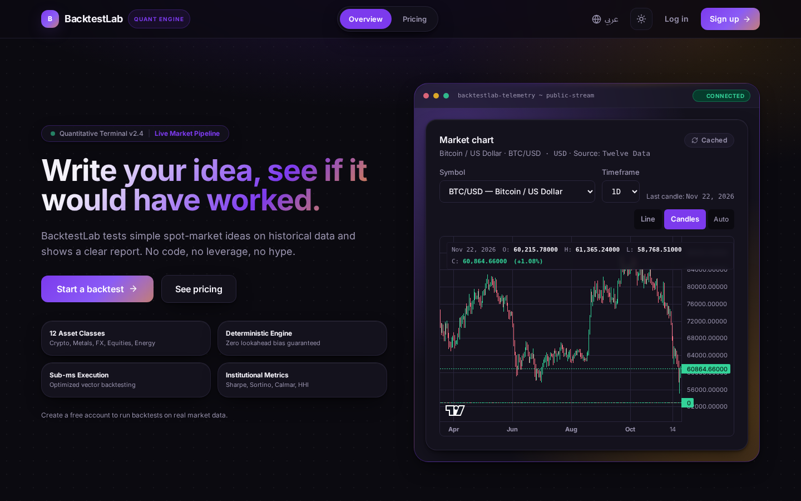
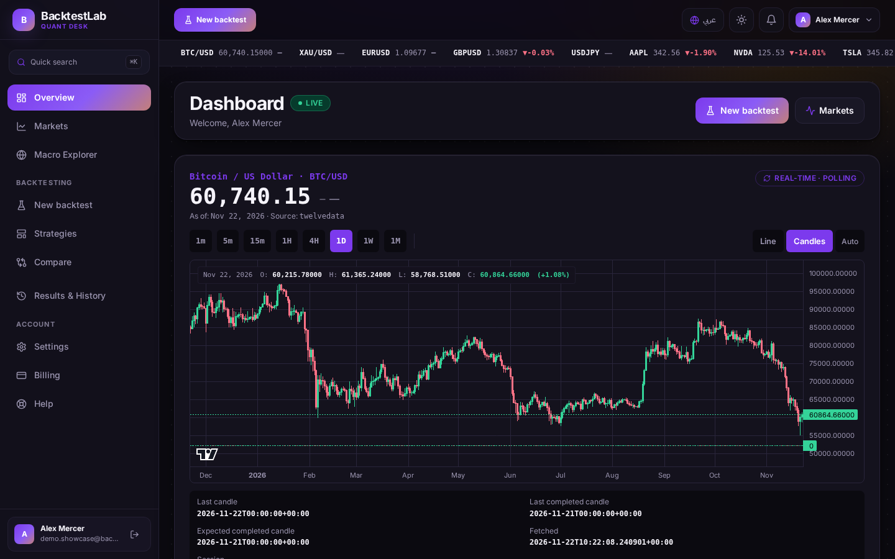
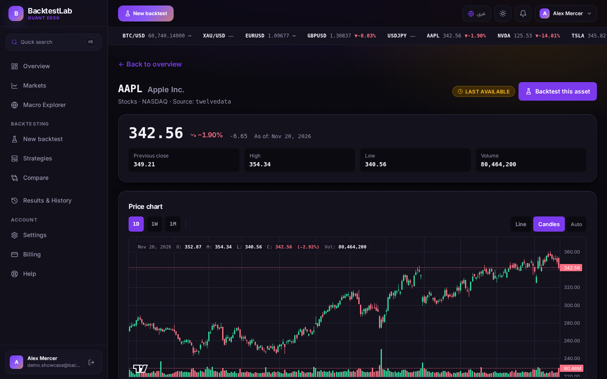
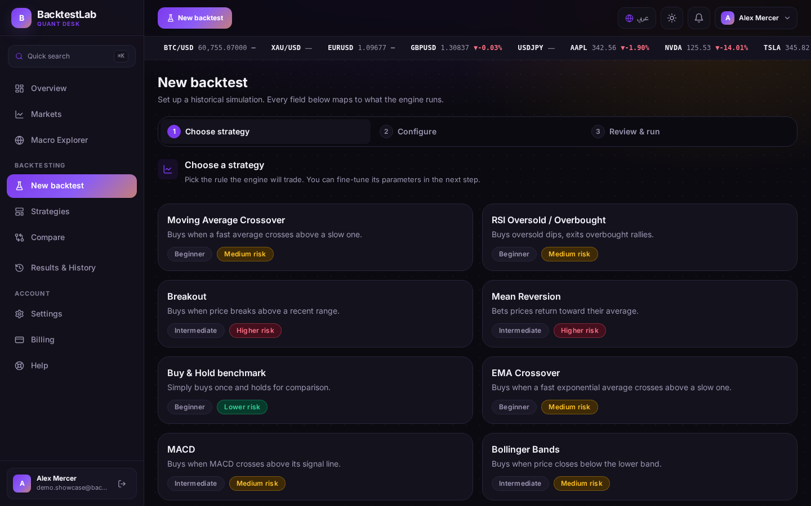
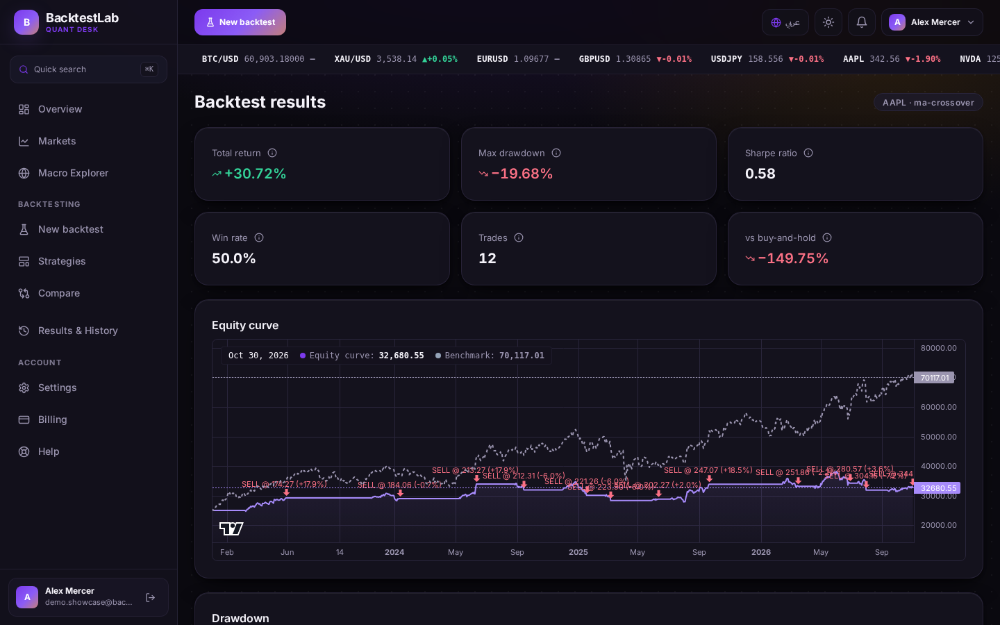
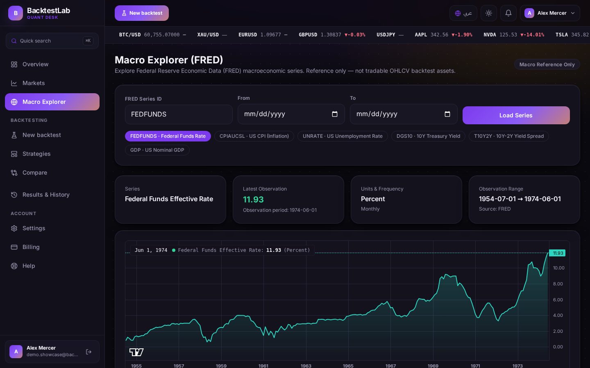
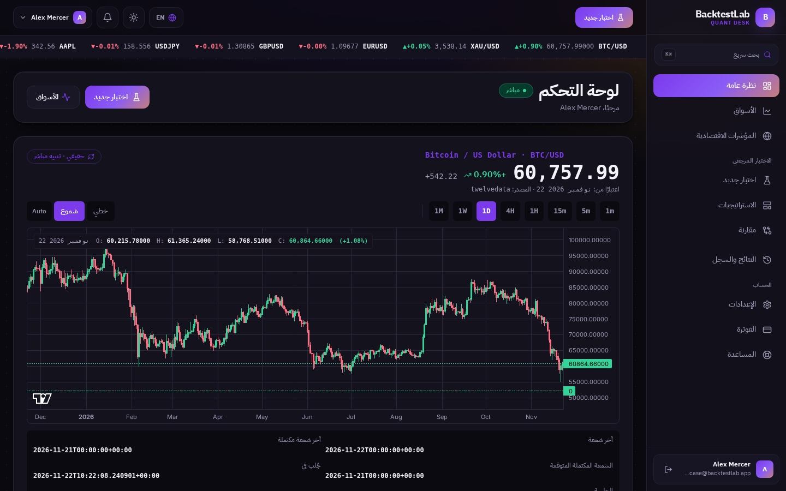

# BacktestLab

BacktestLab is a web application for testing spot trading strategies on historical market data and reading plain, honest performance reports.

I built it because most retail backtesting tools either hide their assumptions behind optimistic numbers, quietly fall back to mock data when an API fails, or require writing boilerplate scripts just to compare a moving average crossover against buy-and-hold. BacktestLab keeps everything explicit: spot-only execution (no leverage or shorting), visible trading costs, conservative stop-loss ordering, and a hard failure (`503`) if the real engine or data provider isn't available.

The interface is bilingual from the ground up — English (LTR) and Arabic (RTL) — with interactive TradingView charts, live market quotes, a FRED macroeconomic explorer, and a background worker queue for running historical simulations.



> **Note:** BacktestLab is a research and simulation tool, not financial advice. Everything runs on spot positions only (1x, long-only).

---

## Screenshots

### Workspace Dashboard & Live Market Feed
Live ticker tape, real-time/polling price updates, timeframe switching (`1m` through `1M`), candlestick/line toggle, and explicit candle freshness metadata.



### Asset Chart View
Interactive OHLCV candlestick and volume charts powered by TradingView `lightweight-charts` v5, with session awareness and one-click jump into backtesting that instrument.



### Strategy & Risk Builder
Three-step wizard to pick a strategy template, tune its parameters, set capital, fees/slippage/spread, stop-loss and take-profit rules, position sizing, and an optional in-sample / out-of-sample split.



### Backtest Results Report
Equity curve plotted against a buy-and-hold benchmark with entry/exit markers, drawdown chart, key risk/return stats (Total Return, CAGR, Max Drawdown, Sharpe, Sortino, Win Rate, Profit Factor, Expectancy), out-of-sample breakdown, and trade log.



### Macro Explorer (FRED)
Browse Federal Reserve Economic Data series (`FEDFUNDS`, `CPIAUCSL`, `UNRATE`, `DGS10`, `T10Y2Y`, `GDP`, or any custom FRED series ID) as macroeconomic reference alongside market research.



### Full Arabic (RTL) Support
Every screen, chart label, navigation layout, and error message works natively in Arabic (`IBM Plex Sans Arabic`) and English (`Inter`) with dark and light themes.



---

## What's Inside

### Backtesting Engine
- **11 built-in spot strategies:** Moving Average Crossover, EMA Crossover, RSI Oversold/Overbought, MACD, Bollinger Bands, Donchian Channel, Breakout, Mean Reversion, Momentum, Dollar-Cost Averaging (DCA), and Buy & Hold benchmark.
- **Market profiles & timeframes:** Handles US, UK, Canada, Hong Kong, Saudi Tadawul, Crypto spot, FX spot, and commodity proxies with interval-aware annualization (`1m`, `5m`, `15m`, `30m`, `1H`, `4H`, `1D`, `1W`, `1M`).
- **Explicit costs & risk controls:** Separate commission, slippage, and spread percentages; stop-loss (`fixed_pct`, `risk_based` with conservative SL-first intrabar evaluation); take-profit; position sizing (`pct_equity`, `fixed_amount`, `risk_based`); and chronological out-of-sample (OOS) split validation.
- **Side-by-side comparison:** Compare equity curves and metrics across multiple completed runs on aligned timestamps.
- **No silent fake data:** When `ENGINE_MODE=vendor` (the default), engine or data failures surface loudly instead of quietly substituting synthetic bars.

### Market Data & Streaming
- **15-provider catalog:** Twelve Data (live quotes, candles, and WebSocket streaming), Polygon.io, Binance public, CCXT, Alpha Vantage, Tiingo, Stooq, Yahoo Finance (`yfinance`), CoinGecko, Frankfurter (FX), FRED (macro), CSV upload, persistent `local_store`, local fixtures, and an offline `synthetic` provider strictly for tests/dev.
- **Persistent local store:** Store and reuse normalized OHLCV bars inside PostgreSQL/SQLite (`market_instruments`, `market_bars`, `market_coverage`) with TTL rules, canonical hashes, and a CLI (`python -m app.cli`) for seeding and ingestion.
- **Honest freshness:** Responses include `data_status`, `is_stale`, `cache_age_s`, and market session state (US equities with holidays/early closes, 24/7 crypto, 24/5 FX, CME schedules).

### Architecture & Security
- **Frontend:** React 18, TypeScript, Vite, Tailwind CSS, Zustand, React Hook Form + Zod, `i18next`, `lightweight-charts` v5, and a `Cmd/Ctrl+K` command palette.
- **Backend:** Python 3.13+, FastAPI, SQLAlchemy 2, Alembic migrations, PostgreSQL 16 (or SQLite for local dev), and Redis 7.
- **Async execution:** Database-backed job queue with a dedicated `worker` service, lease/heartbeat tracking, stale-job recovery, and bounded concurrency.
- **Auth & hardening:** HttpOnly access/refresh cookies (`btlab_access`, `btlab_refresh`) paired with double-submit CSRF tokens (`X-CSRF-Token`), Redis-backed single-use WebSocket tickets (`GETDEL`), account/IP login lockouts, strict script CSP (no `'unsafe-inline'`), structured JSON logs with secret redaction, and Prometheus `/metrics`.

---

## Quick Start

### Option 1: Docker Compose (full stack)

The compose stack runs PostgreSQL 16, Redis 7, an Alembic migration job, the FastAPI backend, the async worker, and an nginx frontend container.

1. Copy the example env files and generate secrets:

```bash
cp .env.example .env
cp backend/.env.example backend/.env
```

2. Export required runtime secrets (or put them in `.env`):

```bash
export LOCAL_JWT_SECRET="$(python3 -c 'import secrets; print(secrets.token_urlsafe(48))')"
export POSTGRES_PASSWORD="$(python3 -c 'import secrets; print(secrets.token_urlsafe(24))')"
```

3. Build and start the stack:

```bash
docker compose up --build -d
```

Open [http://localhost:5173](http://localhost:5173).

Optional: seed the offline local store so you can run backtests without external provider keys:

```bash
docker compose run --rm backend python -m app.cli seed
```

To add live market data and macro series, configure any provider API keys you want in `.env` / `backend/.env` (for example `TWELVEDATA_API_KEY`, `POLYGON_API_KEY`, `FRED_API_KEY`). See [`ENVIRONMENT.md`](ENVIRONMENT.md) for the full variable list.

For production with automatic HTTPS via Caddy, use the production overlay:

```bash
docker compose -f docker-compose.yml -f docker-compose.prod.yml up -d
```

---

### Option 2: Local Development

**Prerequisites:** Python 3.13+, Node.js 20+, npm.

```bash
# 1. Frontend dependencies
npm ci

# 2. Backend virtual environment
python3 -m venv backend/.venv
source backend/.venv/bin/activate
pip install -r backend/requirements-dev.txt

# 3. Environment files
cp .env.example .env
cp backend/.env.example backend/.env
```

Set `LOCAL_JWT_SECRET` (at least 32 characters) in `backend/.env`, and set `VITE_USE_MOCK=false` with `VITE_API_BASE=` (empty, so Vite proxies `/api` to port `8000`) in `.env`.

Run the API and frontend in two terminals:

```bash
# Terminal 1 — FastAPI backend (SQLite by default)
source backend/.venv/bin/activate
cd backend && python -m uvicorn app.main:app --reload --port 8000

# Terminal 2 — Vite dev server
npm run dev
```

If you only want to work on the UI without running the Python backend, leave `VITE_USE_MOCK=true` in `.env` to use the built-in browser mock API.

---

## Testing & Checks

```bash
# Backend unit & integration tests (offline; network sockets blocked in test suite)
cd backend && .venv/bin/python -m pytest -q

# Frontend tests, typecheck, lint, RTL/color checks, and production build
npm run verify

# End-to-end browser suite (Playwright against a real seeded backend)
npm run e2e

# Verify OpenAPI snapshot matches current routes
make check
```

Useful `Makefile` targets: `make setup`, `make test`, `make lint`, `make verify`, `make up`, `make down`, `make seed`, `make openapi-snapshot`.

---

## Repository Structure

```text
src/                        React + TypeScript frontend
  api/                      Typed HTTP client + optional browser mock API
  components/
    charts/                 TradingView Lightweight Charts wrappers & equity curves
    market/                 Ticker tape, live quote table, price charts, freshness badges
    ui/                     Design-system primitives, command palette, modals
  hooks/                    Market data, WebSocket streaming, backtest queries
  i18n/                     en.json and ar.json (parity-tested)
  layouts/                  PublicShell and authenticated AppShell
  pages/                    Landing, Dashboard, Markets, Asset, NewBacktest, Results,
                            Compare, History, Templates, MacroExplorer, Settings, Billing
  stores/                   Zustand stores (auth, preferences, backtest draft)

backend/
  app/                      FastAPI routes, auth/CSRF, SpotBacktestEngine, worker queue,
                            market streaming, Redis store, observability
  app/data_providers/       15 data providers, routing, validation, diagnostics, cooldowns
  app/data_store/           Persistent OHLCV bar repository, normalization, CLI
  migrations/               Alembic database migrations (SQLite & PostgreSQL)
  tests/                    Pytest suite (contract, engine, providers, security, streaming)
  vendor/Vibe-Trading/      Pinned MIT engine snapshot (see backend/vendor/README.md)

e2e/                        Playwright browser tests
scripts/                    Ops backup/restore scripts, load testing, release checks
docs/                       Architecture, API contract, provider docs, operations, screenshots
```

---

## Documentation

Full technical docs live in [`docs/INDEX.md`](docs/INDEX.md):

- [`ENVIRONMENT.md`](ENVIRONMENT.md) — every frontend and backend environment variable
- [`DEPLOYMENT.md`](DEPLOYMENT.md) — production deployment & TLS notes
- [`docs/API_CONTRACT.md`](docs/API_CONTRACT.md) — HTTP endpoints, error codes, auth & rate limits
- [`docs/DATA_PROVIDERS.md`](docs/DATA_PROVIDERS.md) — provider capabilities, rate limits, and how to add a provider
- [`docs/DATA_STORE.md`](docs/DATA_STORE.md) — local bar store schema, TTL rules, and CLI reference
- [`docs/OPERATIONS.md`](docs/OPERATIONS.md) — worker recovery, backups, logging, and health checks
- [`docs/SECURITY_NOTES.md`](docs/SECURITY_NOTES.md) — threat model, cookie/CSRF setup, and hardening

---

## Third-Party Notices

BacktestLab vendors a pinned MIT-licensed snapshot of `Vibe-Trading` under `backend/vendor/Vibe-Trading/` and uses TradingView's Apache-2.0 `lightweight-charts` library for interactive charts. See [`THIRD_PARTY_NOTICES.md`](THIRD_PARTY_NOTICES.md) for attributions and licenses.
