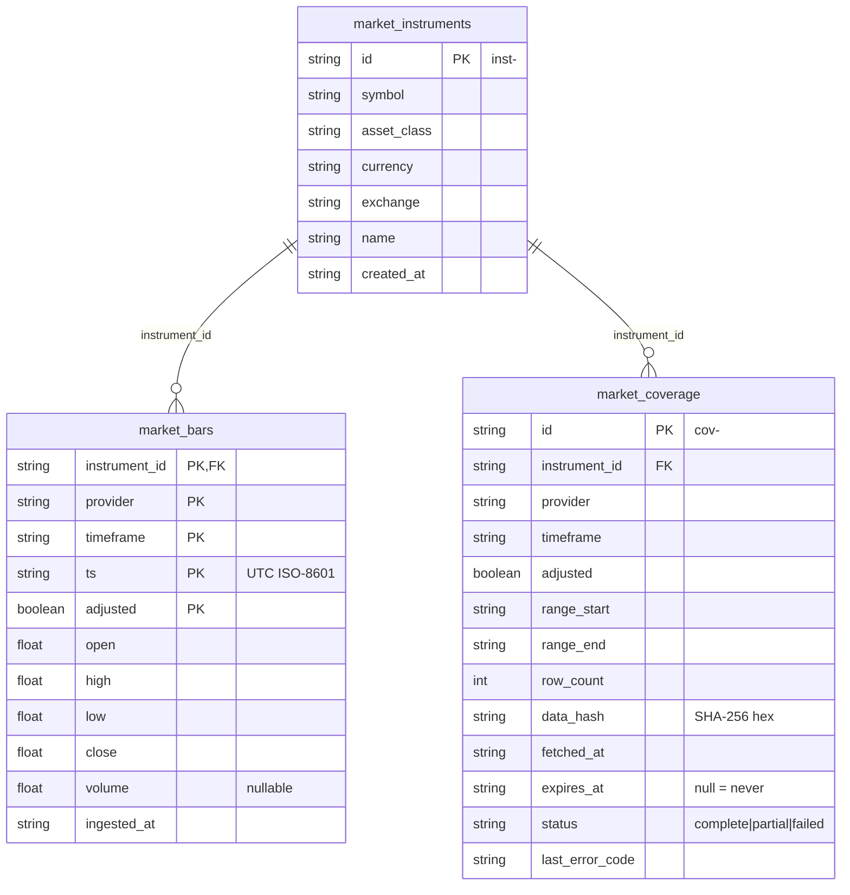

# Market data store — BacktestLab

The market data store is a persistent OHLCV cache/history that lives in the
same SQLAlchemy database as users, backtests and jobs. It is populated by the
CLI (`seed`, `ingest`, `ingest-file`, `backfill`) and served offline by the
`local_store` provider. It is **not** a transparent cache in front of every
live provider request; the API/worker path fetches from the selected provider
(see [`DATA_PROVIDERS.md`](DATA_PROVIDERS.md)), while `dataProvider=local_store`
reads only the store.

---

## 1. Schema

Models: `backend/app/db.py`. Migrations: `backend/migrations/versions/`.



### Keys and invariants

- Instrument id: `"inst-" + sha256(f"{symbol}|{asset_class}")[:16]`. The same
  symbol can exist in more than one asset class.
- `market_bars` primary key:
  `(instrument_id, provider, timeframe, ts, adjusted)`. Upserts use
  `ON CONFLICT DO UPDATE` (SQLite and PostgreSQL) and update OHLCV +
  `ingested_at`, so re-ingesting the same bars is idempotent.
- `market_coverage` has a generated `id`; logical uniqueness
  `(instrument_id, provider, timeframe, adjusted, range_start, range_end)` is
  enforced by the repository's lookup-then-update, not a DB unique constraint.
- `ts` is a UTC ISO-8601 string. Timestamps are compared lexicographically for
  range queries (`>= start`, `< end`).
- Timeframe keys are lowercase (`1m`, `5m`, `15m`, `30m`, `1h`, `4h`, `1d`,
  `1w`) **except monthly `1M`**, which stays uppercase so it cannot be
  confused with one minute (`1m`).
- Index: `ix_market_bars_instrument_timeframe_ts` on
  `(instrument_id, timeframe, ts)`.

---

## 2. Migration chain

| Revision | Purpose |
|---|---|
| `3d13a8f5db3f` | Initial schema: users, backtests, usage, jobs |
| `5d8a7492f5a8` | `refresh_tokens` (rotation + reuse detection) |
| `b7c21e90af31` | Data provenance columns on `backtests` |
| `cf69763c1c4c` | Market data store: `market_instruments`, `market_bars`, `market_coverage` |
| `8f2c1d4e6a90` | **Head** — worker lease/heartbeat/retry columns + composite indexes |

```bash
cd backend
python -m alembic heads          # exactly one: 8f2c1d4e6a90
python -m alembic upgrade head
python -m alembic downgrade 5d8a7492f5a8
python -m alembic upgrade head
python -m alembic check
```

The downgrade to `5d8a7492f5a8` is destructive for store/provenance/reliability
data; take a backup first. CI runs the round-trip on PostgreSQL 16, and the
SQLite round-trip is part of the release checklist.

---

## 3. Coverage and TTL

Coverage rows describe which ranges are already stored for a given
`(instrument, provider, timeframe, adjusted)`.

`MarketDataService.get_bars()` follows this decision tree:

1. **Expired rows are ignored.** `expires_at` in the past (or unparseable) is
   treated as missing, so it can be refreshed.
2. If a single `complete`, unexpired row covers `[start, end)` →
   `retrieval="store"`; no provider call.
3. Otherwise compute the missing sub-ranges from the sorted coverage rows,
   fetch only those from the provider, normalize, upsert bars, merge with
   stored bars, and write a new complete coverage row for the full requested
   range → `retrieval="partial"` (or `"live"` when nothing was covered).
4. `refresh=True` skips steps 2–3 and refetches the full range.

TTL policy (`backend/app/data_store/ttl.py`, read from env at call time):

| Timeframe | Rule |
|---|---|
| `1m`, `5m`, `15m`, `30m`, `1h`, `4h` | `expires_at = now + DATA_STORE_TTL_INTRADAY_MINUTES` (default 60) |
| `1d`, `1w`, `1M` with `range_end` older than `DATA_STORE_TTL_DAILY_DAYS` (default 7) | never expires (`expires_at = null`) |
| `1d`, `1w`, `1M` recent | `expires_at = now + DATA_STORE_TTL_RECENT_HOURS` (default 24) |

Coverage `status` is written as `complete` on success. `partial`/`failed` and
`last_error_code` exist in the schema for diagnostics; a non-`complete` row is
not treated as a full hit.

`local_store` itself does **not** apply TTL — it serves the bars that exist.

---

## 4. Normalization

`backend/app/data_store/normalize.py` is the single validation pipeline before
bars enter the store:

- require OHLC columns, add `volume=0` when absent;
- parse the index/date column to UTC, sort ascending;
- drop rows with NaT timestamps, NaN OHLC, non-positive prices,
  `high < max(open, close, low)`, `low > min(open, close, high)`,
  duplicate timestamps, or future timestamps;
- each drop adds a warning (`DROPPED_NAT_TIMESTAMP`, `DROPPED_NAN_OHLC`,
  `DROPPED_NON_POSITIVE_PRICE`, `DROPPED_BAD_HIGH`, `DROPPED_BAD_LOW`,
  `DROPPED_DUPLICATE_TS`, `DROPPED_FUTURE_TS`);
- ranges larger than the timeframe budget are rejected:
  `1m` 7 days, `5m` 30, `15m` 60, `30m` 90, `1h` 180, `4h` 365, `1d`/`1w`/`1M`
  3650;
- gaps larger than 3× the expected step add `LARGE_GAP`;
- bars are never fabricated. Empty results raise `EMPTY_DATA` or
  `DATA_NOT_IN_STORE`.

---

## 5. Canonical hashes

There are two deterministic 64-lowercase-hex SHA-256 hashes in the system. They
are both stable, but they cover different serializations and must not be
compared across layers.

### 5.1 Store coverage hash (`_canonical_hash`)

Used by `market_coverage.data_hash`, `ingest`/`seed`, `verify` and
`GET /api/v1/data-store/hash-stability`.

```
line_i = f"{ts}|{open:.6f}|{high:.6f}|{low:.6f}|{close:.6f}|{volume_or_0:.6f}"
payload = "\n".join(line_i)
data_hash = sha256(payload.encode()).hexdigest()
```

`ts` is the stored UTC ISO-8601 string; a missing/`None`/zero volume formats as
`0.000000`. Recomputing the hash from the stored bars must equal the coverage
row's `data_hash`; `verify` and the hash-stability endpoint report
`{expected, actual, ok}` per row.

### 5.2 Provider provenance hash (`frame_hash`)

Used for the `dataHash` field in API/backtest provenance
(`backend/app/data_providers/base.py`).

```
payload = index.strftime("%Y-%m-%dT%H:%M:%SZ").tolist()
        + [round(float(x), 6) for x in frame.to_numpy().ravel()]
dataHash = sha256(repr(payload).encode()).hexdigest()
```

It covers the normalized provider frame (timestamps + OHLCV values). The same
bars always produce the same hash, which is the reproducibility guarantee in
the API contract.

---

## 6. CLI reference

Run from `backend/` with the target database in `DATABASE_URL`:

```bash
export DATABASE_URL=sqlite:///./backtestlab.db
python -m app.cli <command>
# alias: python -m app.data_store.cli <command>
```

| Command | Purpose | Example |
|---|---|---|
| `seed` | Deterministic synthetic GBM bars for a universe into the store; no network | `python -m app.cli seed --start 2022-01-01 --end 2023-12-31` |
| `ingest` | Fetch through `MarketDataService` (store read-through) and persist | `python -m app.cli ingest local AAPL --start 2022-01-01 --end 2023-12-31` |
| `ingest-file` | Load a CSV file directly into the store | `python -m app.cli ingest-file data/AAPL.csv --symbol AAPL --provider csv_upload` |
| `backfill` | Fill all symbols in a universe/provider | `python -m app.cli backfill --universe us_large_caps --provider yfinance` |
| `list` | Print enabled providers + capabilities + `local_store` summary | `python -m app.cli list` |
| `stats` | Instrument/bar/coverage counts, oldest/newest bar, last ingest | `python -m app.cli stats` |
| `verify` | Recompute coverage hashes; exit 1 on corruption | `python -m app.cli verify` |
| `purge` | Delete bars matching filters, or all bars + coverage | `python -m app.cli purge --provider local --older-than 2023-01-01` |
| `export` | Export stored bars for a symbol/range to CSV | `python -m app.cli export AAPL --start 2022-01-01 --end 2022-12-31 --output aapl.csv` |

Notes:

- `seed` reads `backend/data/universe.yaml` by default (20 symbols) and stores
  every symbol as `asset_class="equity"` with the provider id `synthetic`.
  `--universe <name|path>` accepts a short name under `data/universe/`
  (`us_large_caps`, `crypto_majors`, `fx_majors`, `macro_basics`) or a path.
- `ingest`/`backfill` require network + provider keys/packages; failures exit
  non-zero and name the provider.
- `purge` without filters deletes **all bars and all coverage** (instruments
  remain). A filtered purge deletes matching bars only; coverage rows can then
  be stale, so a later full purge or targeted maintenance is required.
- `export` writes `date,open,high,low,close,volume`.

Symbol mapping lives in `backend/data/symbol_map.yaml` (canonical → provider
symbol) and `backend/data/universe*.yaml` (tracked symbol universes).

---

## 7. Read-only store endpoints

All require a bearer token.

| Endpoint | Response |
|---|---|
| `GET /api/v1/data-store/availability` | `{enabled[], default, providers[{id,nameEn,nameAr,category,available,availableDetail,requiresKey,requiresKeyEnv,licenseClass}]}` |
| `GET /api/v1/data-store/coverage?limit&offset` | `{items[], instruments[], total, limit, offset, providers[], providerCounts{}, storeEnabled}` |
| `GET /api/v1/data-store/instruments?limit&offset` | `{items[], total, limit, offset, timeframes[], providers[], completeCoverageRows}` |
| `GET /api/v1/data-store/hash-stability?limit&offset` | `{stable, checks[{id,instrumentId,provider,timeframe,rangeStart,rangeEnd,expected,actual,ok,rows}], partial, limit, offset}` |

Pagination: default 100, maximum 500 for the store endpoints. The
`hash-stability` response sets `partial=true` when a full page was returned
(i.e. more rows may remain).

---

## 8. Backup and restore

### SQLite (dev/small deployments)

```bash
# consistent online backup (WAL-safe)
sqlite3 backend/backtestlab.db ".backup '/backup/backtestlab-$(date +%F).db'"

# restore (stop API + worker first)
cp /backup/backtestlab-2026-11-04.db backend/backtestlab.db
sqlite3 backend/backtestlab.db "PRAGMA integrity_check;"
```

If copying files manually, stop the API/worker and copy `*.db`, `*.db-wal` and
`*.db-shm` together. The provider CSV cache and upload directory are not part
of the database backup.

### PostgreSQL (production)

```bash
# custom-format dump
pg_dump -Fc -U backtestlab -h localhost backtestlab > /backup/bt-$(date +%F).dump

# inside Docker
docker compose exec -T postgres pg_dump -Fc -U backtestlab backtestlab \
  > /backup/bt-$(date +%F).dump

# restore into an empty database
pg_restore --clean --if-exists -U backtestlab -h localhost -d backtestlab \
  /backup/bt-2026-11-04.dump
```

After restore: run `alembic current`/`upgrade head`, call `/ready`, and run
`python -m app.cli verify` to confirm coverage hashes.

---

## 9. Retention and growth

The store has **no automatic deletion job**. Coverage TTL controls *refresh*,
not retention; expired rows remain until rewritten or purged.

- Delete one user's backtest: `DELETE /api/v1/backtests/{id}` (owner).
- Delete old bars: `python -m app.cli purge --older-than YYYY-MM-DD`
  (optionally with `--provider`/`--symbol`).
- Delete everything: `python -m app.cli purge` (bars + coverage).
- Result rows (`backtests`) have no automatic retention policy;
  `RESULT_RETENTION_DAYS` is not implemented. Add a scheduled job (SQL or a
  small script) if a retention period is required.
- Size drivers: `market_bars` grows with instruments × providers × timeframes ×
  bars. Check with:
  `python -m app.cli stats` or
  `SELECT provider, timeframe, count(*) FROM market_bars GROUP BY 1,2;`
- Postgres maintenance: autovacuum is sufficient for normal churn; run
  `VACUUM (ANALYZE)` after a large purge.
- SQLite maintenance: `VACUUM` after a large purge; WAL is enabled
  (`journal_mode=WAL`, `synchronous=NORMAL`, `busy_timeout`).

---

## 10. Operational checks

```bash
# integrity of stored coverage hashes (exit 1 when corrupted)
python -m app.cli verify

# what is stored
python -m app.cli stats

# is the offline provider usable?
curl -fsS http://localhost:8000/api/v1/data-providers | jq \
  '.items[] | select(.id=="local_store") | {available, availableDetail, storeSummary}'
```

`/ready` checks that the store is readable (`market_instruments` select) in
addition to DB connectivity and Alembic head. If coverage hashes fail, first
identify the row in the `verify` output, then re-ingest that instrument/provider
range or purge and refill it. Do not edit `data_hash` by hand.
